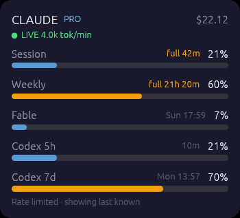
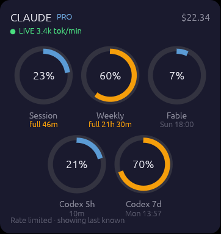

# AgentGauge

AgentGauge tracks Claude Code and OpenAI Codex plan usage through an
always-on-top desktop widget, a KDE panel widget, and the `agent-gauge` CLI.
It shows 5-hour and weekly utilisation, model-scoped weekly caps, reset
countdowns, and API-equivalent cost estimates from local Claude transcripts.

Single static-ish binary, built with [egui/eframe](https://github.com/emilk/egui).

## Screenshots

| Bars view | Gauge view |
|:---:|:---:|
|  |  |

When a window is on pace to run out before it resets, its reset countdown is
replaced by an amber **`full …`** estimate (Session and Weekly above); the
other rows keep their reset times. See [Limit forecast](#limit-forecast).

## Features

- **Real plan data** from Claude Code's `/api/oauth/usage` endpoint, using the
  token Claude Code already stored (`CLAUDE_CODE_OAUTH_TOKEN` → `~/.claude/.credentials.json`
  → macOS Keychain). The widget never refreshes or writes the token.
- **Calm failure modes**: on 429 it shows the last known values (from
  `~/.claude/usage-history.jsonl`, clamping windows that already reset) and backs
  the refresh interval off up to `refresh_max_seconds`; an expired token dims the bars.
- **Cost estimate** per model from `~/.claude/projects/**.jsonl`, including Task
  subagent transcripts, de-duplicated per message id, with 1-hour cache writes
  and long-prompt tiers priced correctly. Transcripts are read incrementally.
- **OSD**: bars or gauge view, 11 themes, drag to move, scroll to resize
  (0.6×–4×), minimize to a thin strip, opacity, corner snapping.
- **Right-click menu**: details, refresh, opacity, view, position,
  **Agents** (Claude / Codex on-off), **Show** (pick which rows appear), theme,
  minimize, always on top, **show in taskbar**, version, last update, quit.
- **Details window** (left-click): limits, cost by model, top projects, running sessions.
- **Live badge**: `LIVE 5.3k tok/min` under the title while a Claude Code
  session (or its subagents) is writing — output tokens over the last 5 minutes,
  shown when a turn landed in the last 90 s. Also in `--field live_activity`.
- **OpenAI Codex (opt-in)**: Codex 5h / weekly rows beneath Claude's (see below).
- **Limit forecast**: fits a usage rate to the window's recent samples
  (`usage-history.jsonl`; last 45 min for 5-hour windows, 24 h for weekly) and
  shows `full 1h 20m` instead of the reset time when a window is on pace to run
  out before it resets. Shown in the OSD, details window, panel widget and
  `--statusline`; in `--field forecasts` as `{rate_per_hour, exhausts_at}`.
  Codex forecasts need a long-running OSD or panel service (no on-disk history).
- **Notifications** when a window crosses 75% / 90%, and once per window when
  it's on pace to run out at least 15 min before it resets.
- **CLI** for status bars and scripts.
- **Single instance**: a second launch exits immediately.

## Limit forecast

AgentGauge fits a straight line to the recent readings of each window in
`~/.claude/usage-history.jsonl` and projects when it reaches 100%:

| Window | Readings used | Needs at least |
|---|---|---|
| 5-hour session (Claude, Codex 5h) | last 45 min | 10 min of readings |
| Weekly and model caps (Weekly, Fable, Codex 7d) | last 24 h | 2 h of readings |

- Only readings from the **current** window count (matched by reset time), so
  a reset never skews the rate. A flat or falling trend gives no forecast.
- If the projected time comes **before** the reset you get `full 42m` in the
  OSD, `Full in 42m` in the panel widget (which turns amber), `(full 42m)` in
  `--statusline`, and the rate (`+106%/h`) in the details window. Otherwise the
  details window shows the expected level at reset, e.g. `on pace for ~74% at reset`.
- When the endpoint is rate-limited, the forecast uses the last saved reading
  at the time it was taken, as long as it is under 20 minutes old.
- One notification per window when the projected time is at least 15 minutes
  before the reset (`forecast_notify`; needs `notifications_enabled`).
- `agent-gauge --field forecasts` prints `{"session": {"rate_per_hour": 1.06,
  "exhausts_at": 1794557400}, …}`; `exhausts_at` is `0` when the window won't
  run out before it resets.
- Codex has no history file, so Codex forecasts appear only after the OSD or
  panel service has been running long enough to collect readings.

Turn it off with `"forecast_enabled": false`.

## Build & install

```bash
cargo build --release
install -Dm755 target/release/agent-gauge ~/.local/bin/agent-gauge
```

Linux builds need the usual windowing dev libraries (X11/Wayland, xkbcommon,
OpenGL); notifications use D-Bus in pure Rust, so no libdbus is required.

### macOS

```bash
./scripts/install-macos.sh                # build, install, start now and at login
./scripts/install-macos.sh --no-autostart # install the app only
./scripts/install-macos.sh --uninstall    # stop and remove (config/cache kept)
```

The installer builds a release binary, wraps it in an ad-hoc-signed
`~/Applications/AgentGauge.app` (bundle id `com.github.agent-gauge`), links
`~/.local/bin/agent-gauge` to it for the CLI and statusLine, and registers a
LaunchAgent (`~/Library/LaunchAgents/com.github.agent-gauge.plist`). launchd
restarts it after a crash; **Quit** from the menu keeps it stopped until the next
login. Logs go to `~/.cache/agent-gauge/widget.log`. Re-running the script updates
the install. Only Xcode Command Line Tools and Rust are required.

- **Credentials:** Claude Code keeps its token in the login Keychain. The first
  read runs `/usr/bin/security`, and macOS may ask for permission. Choose
  **Always Allow**.
- **Dock icon:** hidden by default. **Show window in taskbar** shows a Dock icon and
  Cmd-Tab entry instead (the widget restarts to apply it).
- **Always on top** also keeps the OSD on every Space and over full-screen apps.
- **Notifications:** allow *AgentGauge* in System Settings → Notifications. When
  you run the bare binary instead of the app, notifications come from a generic sender.
- Config and cache use the same `~/.config/agent-gauge` / `~/.cache/agent-gauge`
  paths as on Linux. `force_x11` and the KDE panel widget are Linux-only.

## Usage

```bash
agent-gauge                 # launch the OSD (foreground)
agent-gauge --detach        # launch in the background (logs: ~/.cache/agent-gauge/widget.log)

agent-gauge --json          # full stats as JSON (alias: --once)
agent-gauge --field session_utilization
agent-gauge --statusline    # "S 42% · W 18% · $3.21 · Fable 55%"
                            # "S 62% (full 1h20m) · W 18% · …" when on pace to run out
agent-gauge --export csv --days 7
agent-gauge --config /path/to/config.json …
```

**OSD controls:** left-click = details · drag = move · right-click = menu ·
scroll = resize.

### Claude Code statusLine

```json
{ "statusLine": { "type": "command", "command": "agent-gauge --statusline" } }
```

## Configuration

`$XDG_CONFIG_HOME/agent-gauge/config.json` (default `~/.config/agent-gauge/config.json`).
On startup, AgentGauge copies missing configuration and cache files from the
legacy `claude-usage` directories into `agent-gauge` directories. Existing new
files take precedence; originals are preserved. Locks and temporary files are
excluded. Explicit `--config` paths bypass default configuration migration.
Provider credentials, transcripts, and usage history stay in their existing locations.
Unknown configuration keys are preserved when saving. See `config.json.example`.

| Key | Default | Meaning |
|---|---|---|
| `claude_dir` | `~/.claude` | Claude Code data directory |
| `refresh_seconds` / `refresh_max_seconds` | 60 / 300 | refresh interval and back-off ceiling |
| `statusline_cache_path` | `""` | optional statusline rate-limit dump (zero-cost source) |
| `usage_endpoint_min_seconds` | 300 | min gap between endpoint calls while that dump is fresh |
| `osd_view_mode` | `bars` | `bars` or `gauge` |
| `osd_position` | `top-right` | corner, or `custom` with `osd_x`/`osd_y` |
| `osd_opacity`, `osd_scale`, `osd_minimized` | 0.75, 1.0, false | appearance |
| `osd_always_on_top` | true | keep above other windows |
| `show_in_taskbar` | false | show the OSD as a regular taskbar entry |
| `force_x11` | true | Linux: run under XWayland when available (see below) |
| `theme` | `default` | `default`, `catppuccin-mocha`, `dracula`, `nord`, `gruvbox-dark`, `terminal`, `dashboard`, `hud`, `receipt`, `strip`, `brutalist` |
| `notifications_enabled`, `notify_thresholds` | true, [0.75, 0.9] | threshold notifications |
| `forecast_enabled` | true | project when each limit runs out from the recent usage rate |
| `forecast_notify` | true | notify once per window when a limit is on pace to run out before it resets |
| `providers` | `["claude"]` | agents to track: `"claude"`, `"codex"` (menu → Agents) |
| `osd_hidden_rows` | `[]` | rows to hide: `session`, `weekly`, `scoped`, `codex_session`, `codex_weekly`, `cost`, `live` (menu → Show) |
| `codex_poll_seconds` | 300 | how often to query `codex app-server` (disk cache in between) |
| `codex_bin` | `""` | path to the `codex` CLI; empty = `PATH`, then known install locations |

### Second provider: OpenAI Codex

```json
{ "providers": ["claude", "codex"] }
```

The widget asks your local `codex` CLI for its limits over stdio JSON-RPC
(`codex app-server` → `account/rateLimits/read`) — the same numbers Codex
reports itself. The call is bounded to 12 s, made at most every
`codex_poll_seconds`, and cached in `~/.cache/agent-gauge/codex_limits.json`
(copied from the legacy cache on first use). The `codex` binary is found via `codex_bin`,
then `PATH`, then `/usr/lib/chatgpt/resources/codex` (ChatGPT desktop on Linux),
`/opt/homebrew/bin/codex`, `/usr/local/bin/codex` and `~/.local/bin/codex`.
On macOS it then uses the CLI bundled in the ChatGPT desktop app
(`Contents/Resources/codex-cli/bin/codex`), located through Launch Services so
it works wherever the app is installed. Rows hide automatically
when Codex is missing or logged out (`codex login` brings them back).

### KDE top-panel usage text (Plasma 6)

To show always-visible Claude and Codex percentages beside your CPU/MEM meters:

```bash
./scripts/install-panel.sh
```

The installer builds the binary, enables both providers while preserving your
other settings, installs the **AgentGauge** Plasma widget, and starts a headless
user service instead of the floating OSD. It adds the widget to the top panel
beside KStats when present. Re-running updates the installation without adding
another widget. The existing Plasma plugin ID is retained to preserve widget
layout and settings. The installer stops and disables `claude-usage.service`
before enabling `agent-gauge.service`. Existing app config and service files are backed up once with
`.before-panel` suffixes.

Requires Plasma 6, `kpackagetool6`, Plasma5Support’s executable data engine,
Python 3, and a working systemd user session. Run from your desktop session.
The panel can also be added manually through **Edit Panel → Add Widgets →
AgentGauge**. Widget settings control row visibility and an optional absolute
binary path (default: `~/.local/bin/agent-gauge`). Provider collection remains
controlled by `providers` in the app’s `config.json`.

Each provider gets a compact row with 5-hour and weekly percentages. Click for
bars, reset countdowns, provider errors, and the update time. Unknown readings
show `--`; stale or failed readings are dimmed. Warning colors use the configured
notification thresholds. The popup retains last-known readings through failures.

```bash
agent-gauge --panel-service   # persistent collection, no window
agent-gauge --panel-snapshot  # cached JSON only; never collects or calls an API
systemctl --user status agent-gauge.service
journalctl --user -u agent-gauge.service
```

The widget reads `$XDG_CACHE_HOME/agent-gauge/panel-snapshot.json` through the
snapshot command every five seconds. Collection keeps the existing configured
intervals, incremental scanner, backoff, and notifications. Config changes are
picked up automatically. Desktop and panel-service modes share the instance
lock. To return to the floating OSD, stop the service before launching normally:

```bash
systemctl --user disable --now agent-gauge.service
agent-gauge --detach
```

Development checks: `cargo test`, `node tests/panel-widget.cjs`, and
`python3 -s tests/check-panel-qml.py` (requires system PySide6 and KDE QML modules).

### Taskbar setting

**Show window in taskbar** controls the window’s task entry. For usage text in
the KDE top panel, use the Plasma widget above.

- **Linux (X11/XWayland):** toggled live via the EWMH `_NET_WM_STATE_SKIP_TASKBAR` hint.
- **macOS:** controls the Dock icon and Cmd-Tab entry (app activation policy);
  toggling from the menu restarts the widget.
- **Windows:** applied at window creation; toggling from the menu restarts the widget.
- **Native Wayland:** the compositor decides; the setting has no effect.

### Wayland

Native Wayland doesn't let apps position their own windows, stay on top, or
hide from the taskbar. With `force_x11: true` (default) the widget runs under
XWayland when `DISPLAY` is available. Set it to `false` for a pure Wayland window.

### statusline cache file

If your statusLine script tees its payload to a file shaped like

```json
{"captured_at": "2026-07-11T22:52:05+09:00",
 "rate_limits": {"five_hour": {"used_percentage": 54, "resets_at": 1783795800},
                 "seven_day": {"used_percentage": 46, "resets_at": 1784026800}}}
```

point `statusline_cache_path` at it: while it's fresh the endpoint is skipped
(forced at most every `usage_endpoint_min_seconds`), and when the endpoint
throttles, a dump younger than 20 minutes beats the last stored sample.

## Autostart (systemd user service)

On macOS use `./scripts/install-macos.sh`, which installs a LaunchAgent (see [macOS](#macos)).

```ini
# ~/.config/systemd/user/agent-gauge.service
[Unit]
Description=AgentGauge
After=graphical-session.target

[Service]
ExecStart=%h/.local/bin/agent-gauge
Restart=on-failure

[Install]
WantedBy=graphical-session.target
```

```bash
systemctl --user enable --now agent-gauge
```

## Roadmap

Ideas not built yet: update checker.

## Development

```bash
cargo test
cargo clippy --all-targets -- -D warnings
```

## License

MIT.
